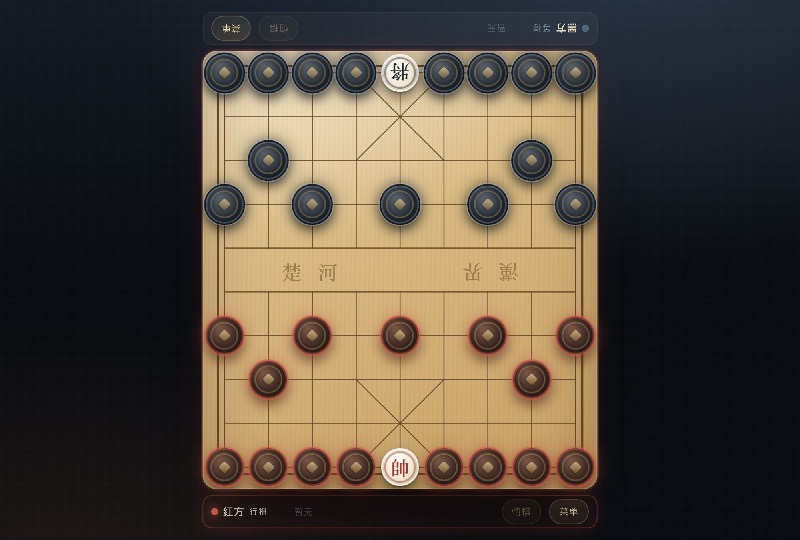
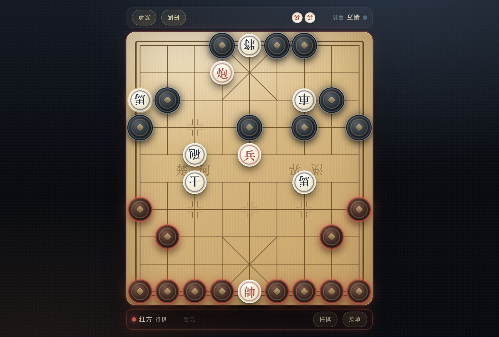
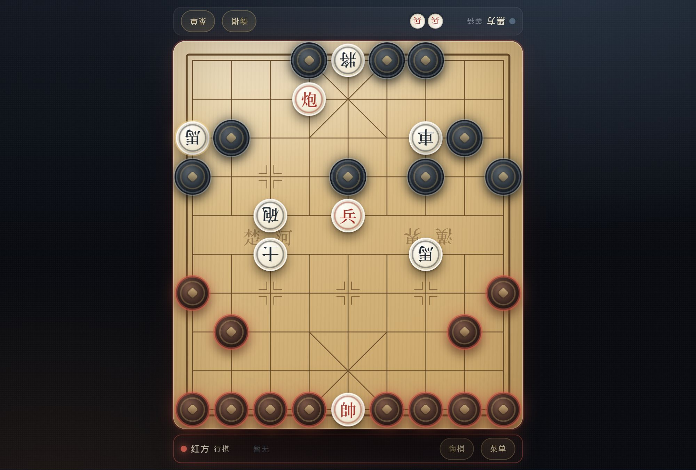

# 暗棋象棋 · 位置身份 · 将帅明置

红帅、黑将**开局明置九宫**，其余 30 枚棋子随机暗置。暗子**保留当前位置的兵种与所属方**，先按位置身份走子/吃子，走完才翻面；翻面后恢复真实身份——刚才像車一样走，翻开却可能是兵，甚至变成对方棋子。

## 界面

| 开局（将帅明置 + 30 枚暗子） | 中局（翻面、吃子、战利品） |
| --- | --- |
|  |  |

全屏（剧场）模式：只保留棋盘与两侧战利品队列。



- 红方在下、黑方在上；黑方区域与黑方棋子文字整体旋转 180°，两人对坐也能正读。
- 暗子按阵营带光晕：红方阵地红晕、黑方阵地暗色光晕。
- 两侧各有战利品队列与悔棋按钮，吃子按“谁吃”归方。
- 被将军时，将帅与正在将军的敌方棋子会高亮。

## 运行

直接用浏览器打开 `index.html` 即可（无需构建）。

也可以起一个本地静态服务器：

```bash
cd game
python3 -m http.server 4173
# 打开 http://127.0.0.1:4173/index.html
```

## 规则

### 开局
- 红帅固定在九宫 (4,9)、黑将固定在九宫 (4,0)，**开局即明棋**。
- 其余 30 枚棋子（双方各 15 枚，不含将帅）**完全随机暗置**在其余 30 个点位上。
- 每个点位同时决定暗子的**位置兵种**与**位置归属**：
  - **位置兵种**：标准棋局里该位置的兵种，决定走法。
  - **位置归属**：标准棋局里该位置属于红还是黑。红方阵地上的暗子归红方管，黑方阵地上的归黑方管。

### 暗子的走法（重点）
- **只能走自己一方的棋子，只能吃对方的棋子**：红方走红方阵地上的暗子与己方明子，黑方同理。
- 暗子先按所在点位的**位置身份**（兵种 + 归属）行走 / 吃子，走完**自动翻面**。
- 翻面后露出**真实兵种与真实归属**，之后按真实身份行动——可能和刚才的走法、归属都不同。
- 翻出是对方棋子：它留在落点，归对方所有。
- 吃暗子也有风险：对方阵地上的暗子翻开后可能是**你自己的**（将帅除外，将帅始终明置）。

### 明子走法
| 棋子 | 走法 |
| --- | --- |
| 車 | 直线任意格，遇子止步 |
| 馬 | 走「日」，蹩马腿 |
| 炮 | 直线走；隔一子吃（暗子也能当炮架） |
| 相 / 象 | 走「田」，塞象眼，**可以过河** |
| 仕 / 士 | 斜走一格，**限九宫** |
| 帥 / 將 | 直走一格，**限九宫**；双方将帅照面可互吃（飞将） |
| 兵 / 卒 | 向前一格；**过河后可向前后左右任意方向走一格** |

### 将军与胜负
- 恢复**将军 / 应将 / 将死**：不能把己方走成被将军；被将军必须应将；无解即将死。
- 暗子按**位置身份**参与将军判定（位置兵种与归属是公开的）。
- 被将军时，**将帅与正在将军的敌方棋子会高亮**。
- 吃掉对方将帅同样获胜；无子可走且未被将军为困毙，判负。

## 文件

- `index.html` — 页面结构
- `style.css` — 棋盘、棋子、面板样式与动画
- `engine.js` — 纯规则引擎（无 DOM 依赖，可单独测试）
- `ui.js` — 渲染与交互

## 双边对弈布局
- 红方在下、黑方在上，两人对坐。
- 上方黑方区域（回合提示、战利品、悔棋/菜单按钮）整体旋转 180°，从对面看是正的。
- 黑方棋子的文字也旋转 180°，红方棋子正向——各自都能正读自己的棋子。
- 楚河正向（红方读），漢界旋转（黑方读）。
- 双方各有一条战利品队列，按“谁吃”归入各自一侧。
- 暗子按阵营带光晕：红方阵地红晕、黑方阵地暗色光晕。

## 操作
- 点击己方暗子 → 显示该**位置兵种**的可走位 → 点击落点，先走子/吃子，再自动翻面。
- 点击己方明子同样可走；点对方棋子会提示“这是对方的棋子”。
- **悔棋**：两侧的“悔棋”按钮，或 `Ctrl / Cmd + Z`，可连续悔棋。
- **菜单**：两侧的“菜单”按钮 → 新局 / 规则 / 棋谱 / 全屏。
- **吃子动画**：被吃的棋子会翻开、放大展示，然后飞入**吃子方**的战利品队列。
- **战利品归属**：按“谁吃”归入红方 / 黑方，与棋子本身是红是黑无关。
- `Esc` 关闭弹窗 / 退出全屏 / 取消选择，`R` 重新开局。
